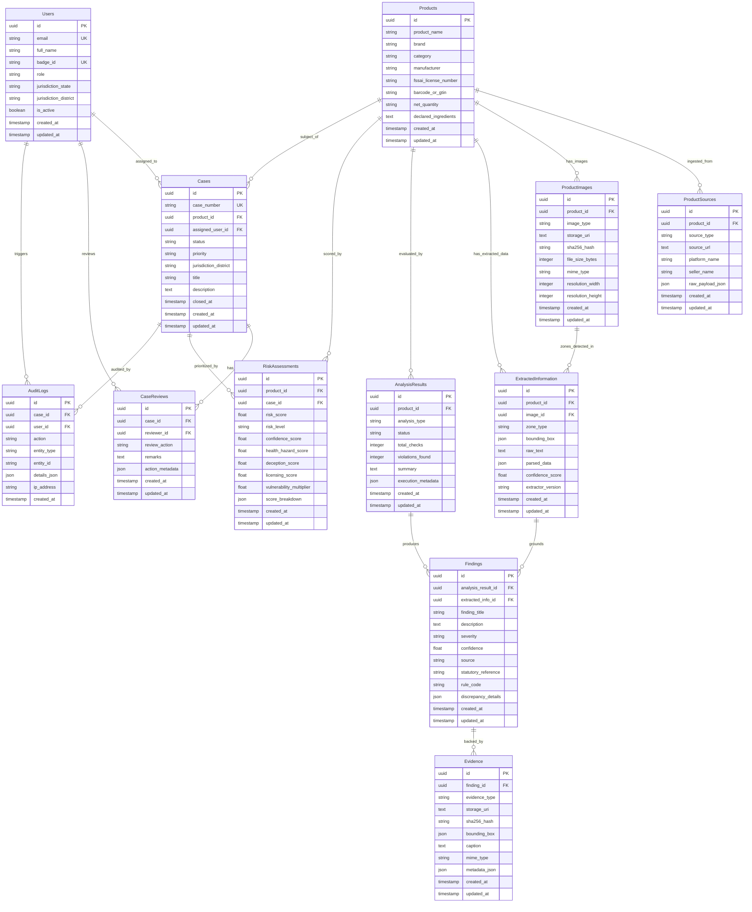

# DRISHTI: Core Database Schema Specification
## Phase 2: Relational Architecture, Data Dictionaries & Entity Relationships

---

### 1. Architectural Design Philosophy

The DRISHTI persistence architecture is designed for **statutory integrity, high auditability, multi-modal ingestion, and strict relational consistency**.

Key principles:
1. **Universal UUID Primary Keys**: Every domain entity uses a cryptographically random UUIDv4 (`Uuid(as_uuid=True)`), preventing enumeration attacks and enabling distributed multi-channel ingestion without primary key collision.
2. **UTC Audit Timestamps**: All entities inherit standard `created_at` and `updated_at` timestamps recorded in UTC with timezone awareness (`DateTime(timezone=True)`).
3. **Flexible JSON / JSONB Semi-Structured Payloads**: While relational integrity governs statutory workflows and foreign key linkages, dynamic extraction payloads (nutritional tables, OCR bounding box polygons, scraped DOM metadata, and audit snapshots) utilize PostgreSQL `JSONB` for schema flexibility and high-speed GIN index queries.
4. **Cascade Policies Optimized for Evidence Integrity**: Deleting a product cascades to its transient scraped sources, images, and raw extracted data. However, formal statutory `Cases` enforce `ondelete="RESTRICT"` on referenced products, preventing accidental destruction of legal investigation files.
5. **Alembic-Driven Versioning**: All schema mutations are version-controlled via Alembic migrations supporting offline generation and batch migration modes.

---

### 2. Entity Relationship Diagram (ERD)



---

### 3. Detailed Data Dictionary

#### 3.1 Entity: `users`
- **Purpose**: System actors representing regulatory officials (Food Safety Officers, Designated Officers, Central Intelligence Analysts, System Administrators, Legal Counsel).
- **Primary Key**: `id` (UUID)

| Column Name | Data Type | Nullable | Default | Description & Constraints |
|---|---|---|---|---|
| `id` | `UUID` | No | `uuid4()` | Unique primary identifier. |
| `email` | `VARCHAR(255)` | No | - | Officer email address (Unique, Indexed). |
| `full_name` | `VARCHAR(255)` | No | - | Full legal name of the regulatory officer. |
| `badge_id` | `VARCHAR(64)` | No | - | Statutory authority badge identifier (e.g. `FSO-DL-042`, Unique, Indexed). |
| `role` | `VARCHAR(50)` | No | - | Access control role (`SUPER_ADMIN`, `CENTRAL_ANALYST`, `DESIGNATED_OFFICER`, `FOOD_SAFETY_OFFICER`, `LEGAL_AUDITOR`). |
| `jurisdiction_state` | `VARCHAR(64)` | Yes | `NULL` | Assigned Indian state jurisdiction code (e.g. `DL`, `KA`, `MH`). |
| `jurisdiction_district` | `VARCHAR(128)` | Yes | `NULL` | District enforcement territory (e.g. `DL-CENTRAL`, `KA-BLR-URBAN`). |
| `is_active` | `BOOLEAN` | No | `TRUE` | Whether the officer account is active for login and assignments. |
| `hashed_password` | `VARCHAR(255)` | Yes | `NULL` | Secure Argon2/Bcrypt password hash for credential authentication. |
| `created_at` | `TIMESTAMP WITH TIME ZONE` | No | `now()` | UTC record creation timestamp. |
| `updated_at` | `TIMESTAMP WITH TIME ZONE` | No | `now()` | UTC last update timestamp. |

- **Indexes**:
  - `ix_users_email` (Unique on `email`)
  - `ix_users_badge_id` (Unique on `badge_id`)
  - `ix_users_role` (Single on `role`)
  - `ix_users_jurisdiction_state` (Single on `jurisdiction_state`)
  - `ix_users_jurisdiction_district` (Single on `jurisdiction_district`)
  - `ix_users_role_jurisdiction` (Composite on `role`, `jurisdiction_state`, `jurisdiction_district`)

---

#### 3.2 Entity: `products`
- **Purpose**: Canonical representation of a food product SKU subject to regulatory surveillance.
- **Primary Key**: `id` (UUID)

| Column Name | Data Type | Nullable | Default | Description & Constraints |
|---|---|---|---|---|
| `id` | `UUID` | No | `uuid4()` | Unique product SKU identifier. |
| `product_name` | `VARCHAR(500)` | No | - | Declared commercial brand title (Indexed). |
| `brand` | `VARCHAR(255)` | No | - | Umbrella brand name (Indexed). |
| `category` | `VARCHAR(255)` | No | - | FSSAI food category taxonomy (Indexed). |
| `manufacturer` | `VARCHAR(500)` | Yes | `NULL` | Declared food business operator or manufacturer (Indexed). |
| `fssai_license_number` | `VARCHAR(14)` | Yes | `NULL` | 14-digit statutory FSSAI license number (Indexed). |
| `barcode_or_gtin` | `VARCHAR(64)` | Yes | `NULL` | EAN-13, UPC, or GTIN product barcode (Indexed). |
| `net_quantity` | `VARCHAR(128)` | Yes | `NULL` | Metric net weight / volume (e.g. `500 g`, `1 L`). |
| `declared_ingredients` | `TEXT` | Yes | `NULL` | Full raw ingredients sequence string as declared. |
| `created_at` | `TIMESTAMP WITH TIME ZONE` | No | `now()` | UTC record creation timestamp. |
| `updated_at` | `TIMESTAMP WITH TIME ZONE` | No | `now()` | UTC last update timestamp. |

- **Indexes**:
  - `ix_products_product_name`, `ix_products_brand`, `ix_products_category`
  - `ix_products_fssai_license_number`, `ix_products_barcode_or_gtin`
  - `ix_products_brand_category` (Composite on `brand`, `category`)

---

#### 3.3 Entity: `product_sources`
- **Purpose**: Tracks the origin channel where the product was identified (Web URL, marketplace listing, dark store, retail shelf).
- **Primary Key**: `id` (UUID)

| Column Name | Data Type | Nullable | Default | Description & Constraints |
|---|---|---|---|---|
| `id` | `UUID` | No | `uuid4()` | Unique source identifier. |
| `product_id` | `UUID` | No | - | Foreign Key -> `products.id` (`ON DELETE CASCADE`). |
| `source_type` | `VARCHAR(64)` | No | - | Channel type (`ECOMMERCE_URL`, `PHYSICAL_RETAIL`, `DARK_STORE`, `FOSCOS_REGISTRY`). |
| `source_url` | `TEXT` | Yes | `NULL` | Full web link to marketplace listing. |
| `platform_name` | `VARCHAR(128)` | Yes | `NULL` | Platform name (`Amazon`, `Blinkit`, `Zepto`, `Instamart`, `BigBasket`). |
| `seller_name` | `VARCHAR(255)` | Yes | `NULL` | Third-party seller or retailer name. |
| `raw_payload_json` | `JSON / JSONB` | Yes | `NULL` | Complete scraped DOM, microdata, JSON-LD, or pricing payload. |
| `created_at` | `TIMESTAMP WITH TIME ZONE` | No | `now()` | UTC record creation timestamp. |
| `updated_at` | `TIMESTAMP WITH TIME ZONE` | No | `now()` | UTC last update timestamp. |

---

#### 3.4 Entity: `product_images`
- **Purpose**: Master packaging image assets with cryptographic integrity hashes.
- **Primary Key**: `id` (UUID)

| Column Name | Data Type | Nullable | Default | Description & Constraints |
|---|---|---|---|---|
| `id` | `UUID` | No | `uuid4()` | Unique image asset identifier. |
| `product_id` | `UUID` | No | - | Foreign Key -> `products.id` (`ON DELETE CASCADE`). |
| `image_type` | `VARCHAR(64)` | No | - | Angle / panel type (`FRONT_OF_PACK`, `BACK_OF_PACK`, `NUTRITION_PANEL`, `INGREDIENT_LIST`, `LICENSE_STAMP`). |
| `storage_uri` | `TEXT` | No | - | S3 / MinIO blob storage URI (`s3://drishti-raw/...`). |
| `sha256_hash` | `VARCHAR(64)` | No | - | SHA-256 cryptographic hash of image bytes (Indexed). |
| `file_size_bytes` | `INTEGER` | Yes | `NULL` | Image size in bytes. |
| `mime_type` | `VARCHAR(64)` | No | `'image/jpeg'` | MIME type (`image/jpeg`, `image/png`, `image/webp`). |
| `resolution_width`| `INTEGER` | Yes | `NULL` | Pixel width. |
| `resolution_height`| `INTEGER`| Yes | `NULL` | Pixel height. |
| `created_at` | `TIMESTAMP WITH TIME ZONE` | No | `now()` | UTC record creation timestamp. |
| `updated_at` | `TIMESTAMP WITH TIME ZONE` | No | `now()` | UTC last update timestamp. |

---

#### 3.5 Entity: `extracted_information`
- **Purpose**: Structured information extracted from packaging images and scraped text.
- **Primary Key**: `id` (UUID)

| Column Name | Data Type | Nullable | Default | Description & Constraints |
|---|---|---|---|---|
| `id` | `UUID` | No | `uuid4()` | Unique extracted zone identifier. |
| `product_id` | `UUID` | No | - | Foreign Key -> `products.id` (`ON DELETE CASCADE`). |
| `image_id` | `UUID` | Yes | `NULL` | Foreign Key -> `product_images.id` (`ON DELETE SET NULL`). |
| `zone_type` | `VARCHAR(64)` | No | - | Extracted zone taxonomy (`NUTRITION_TABLE`, `INGREDIENTS`, `CLAIMS`, `VEG_NONVEG_LOGO`, `FSSAI_LICENSE`). |
| `bounding_box` | `JSON / JSONB` | Yes | `NULL` | Polygon or rectangle coordinates (`{ "x_min": ..., "y_min": ... }`). |
| `raw_text` | `TEXT` | No | - | Verbatim OCR transcription or scraped text. |
| `parsed_data` | `JSON / JSONB` | Yes | `NULL` | Canonical parsed key-values (e.g. `{ "protein_g": 25.0 }`). |
| `confidence_score`| `FLOAT` | Yes | `NULL` | Model extraction confidence score ($0.0$ to $1.0$). |
| `extractor_version`| `VARCHAR(64)` | Yes | `NULL` | Identifier of model version (e.g. `PaddleOCR-v4`, `LayoutLMv3-v1`). |
| `created_at` | `TIMESTAMP WITH TIME ZONE` | No | `now()` | UTC record creation timestamp. |
| `updated_at` | `TIMESTAMP WITH TIME ZONE` | No | `now()` | UTC last update timestamp. |

---

#### 3.6 Entity: `analysis_results`
- **Purpose**: Execution run of regulatory compliance and cross-source checks.
- **Primary Key**: `id` (UUID)

| Column Name | Data Type | Nullable | Default | Description & Constraints |
|---|---|---|---|---|
| `id` | `UUID` | No | `uuid4()` | Unique analysis run identifier. |
| `product_id` | `UUID` | No | - | Foreign Key -> `products.id` (`ON DELETE CASCADE`). |
| `analysis_type` | `VARCHAR(64)` | No | - | Compliance domain (`LABELLING_COMPLIANCE`, `ADVERTISING_CLAIMS`, `ADDITIVES`, `FOSCOS`, `CROSS_SOURCE_CONSISTENCY`). |
| `status` | `VARCHAR(32)` | No | `'COMPLETED'` | Execution state (`PENDING`, `PROCESSING`, `COMPLETED`, `FAILED`). |
| `total_checks` | `INTEGER` | No | `0` | Total regulatory rules evaluated in run. |
| `violations_found`| `INTEGER` | No | `0` | Count of infractions flagged. |
| `summary` | `TEXT` | Yes | `NULL` | Executive textual summary of analysis findings. |
| `execution_metadata`| `JSON / JSONB` | Yes | `NULL` | Performance metrics, model latency, rule versions. |
| `created_at` | `TIMESTAMP WITH TIME ZONE` | No | `now()` | UTC record creation timestamp. |
| `updated_at` | `TIMESTAMP WITH TIME ZONE` | No | `now()` | UTC last update timestamp. |

---

#### 3.7 Entity: `risk_assessments`
- **Purpose**: Multi-dimensional compliance risk score ($R_{prod}$), risk tier classification, and prioritization.
- **Primary Key**: `id` (UUID)

| Column Name | Data Type | Nullable | Default | Description & Constraints |
|---|---|---|---|---|
| `id` | `UUID` | No | `uuid4()` | Unique risk assessment identifier. |
| `product_id` | `UUID` | No | - | Foreign Key -> `products.id` (`ON DELETE CASCADE`). |
| `case_id` | `UUID` | Yes | `NULL` | Foreign Key -> `cases.id` (`ON DELETE SET NULL`). |
| `risk_score` | `FLOAT` | No | - | Composite compliance risk score ($0.0$ to $100.0$, Indexed). |
| `risk_level` | `VARCHAR(32)` | No | - | Categorical severity tier (`CRITICAL`, `HIGH`, `MEDIUM`, `LOW`, Indexed). |
| `confidence_score`| `FLOAT` | No | - | Statistical confidence in risk calculation ($0.0$ to $1.0$). |
| `health_hazard_score` | `FLOAT` | Yes | `NULL` | Toxicological / allergen severity component ($0.0$ to $100.0$). |
| `deception_score` | `FLOAT` | Yes | `NULL` | Deceptive marketing / misbranding component ($0.0$ to $100.0$). |
| `licensing_score` | `FLOAT` | Yes | `NULL` | Regulatory licensing integrity component ($0.0$ to $100.0$). |
| `vulnerability_multiplier`| `FLOAT` | No | `1.0` | Target demographic multiplier (e.g. $1.25$ for infant foods). |
| `score_breakdown` | `JSON / JSONB` | Yes | `NULL` | Mathematical component tree detailing weights and inputs. |
| `created_at` | `TIMESTAMP WITH TIME ZONE` | No | `now()` | UTC record creation timestamp. |
| `updated_at` | `TIMESTAMP WITH TIME ZONE` | No | `now()` | UTC last update timestamp. |

- **Indexes**:
  - `ix_risk_assessments_risk_score`, `ix_risk_assessments_risk_level`
  - `ix_risk_assessments_level_score` (Composite on `risk_level`, `risk_score`)

---

#### 3.8 Entity: `findings`
- **Purpose**: Discrete, legally grounded compliance infractions or cross-source discrepancies.
- **Primary Key**: `id` (UUID)

| Column Name | Data Type | Nullable | Default | Description & Constraints |
|---|---|---|---|---|
| `id` | `UUID` | No | `uuid4()` | Unique finding identifier. |
| `analysis_result_id` | `UUID` | No | - | Foreign Key -> `analysis_results.id` (`ON DELETE CASCADE`). |
| `extracted_info_id` | `UUID` | Yes | `NULL` | Foreign Key -> `extracted_information.id` (`ON DELETE SET NULL`). |
| `finding_title` | `VARCHAR(255)` | No | - | Human-readable infraction title (e.g. `Prohibited Curative Disease Claim`). |
| `description` | `TEXT` | No | - | Technical and legal rationale for the violation. |
| `severity` | `VARCHAR(32)` | No | - | Severity tier (`CRITICAL`, `HIGH`, `MEDIUM`, `LOW`, Indexed). |
| `confidence` | `FLOAT` | No | - | Algorithmic confidence in finding ($0.0$ to $1.0$). |
| `source` | `VARCHAR(64)` | No | - | Evidentiary source (`PACKAGING_LABEL`, `ECOMMERCE_WEB`, `FOSCOS_REGISTRY`, `CROSS_SOURCE_COMPARISON`). |
| `statutory_reference` | `VARCHAR(255)` | Yes | `NULL` | Section & Regulation citation under FSS Act (Indexed). |
| `rule_code` | `VARCHAR(64)` | Yes | `NULL` | Systematic rule identifier (e.g. `FSSAI-ADV-2018-R4-DIABETES`, Indexed). |
| `discrepancy_details` | `JSON / JSONB` | Yes | `NULL` | Cross-source differential matrix values. |
| `created_at` | `TIMESTAMP WITH TIME ZONE` | No | `now()` | UTC record creation timestamp. |
| `updated_at` | `TIMESTAMP WITH TIME ZONE` | No | `now()` | UTC last update timestamp. |

---

#### 3.9 Entity: `evidence`
- **Purpose**: Digital evidentiary artifacts (visual crops, OCR tokens, PDF/A dossiers) supporting findings.
- **Primary Key**: `id` (UUID)

| Column Name | Data Type | Nullable | Default | Description & Constraints |
|---|---|---|---|---|
| `id` | `UUID` | No | `uuid4()` | Unique evidence artifact identifier. |
| `finding_id` | `UUID` | No | - | Foreign Key -> `findings.id` (`ON DELETE CASCADE`). |
| `evidence_type` | `VARCHAR(64)` | No | - | Artifact format (`IMAGE_CROP`, `RAW_DOM_SNIPPET`, `FOSCOS_SNAPSHOT`, `STATUTORY_DOSSIER_PDF`). |
| `storage_uri` | `TEXT` | No | - | S3 / MinIO storage URI. |
| `sha256_hash` | `VARCHAR(64)` | No | - | SHA-256 cryptographic hash (Indexed for tamper verification). |
| `bounding_box` | `JSON / JSONB` | Yes | `NULL` | Pixel coordinate region of interest on the source image. |
| `caption` | `TEXT` | Yes | `NULL` | Descriptive explanation of what the visual crop proves. |
| `mime_type` | `VARCHAR(64)` | No | `'image/jpeg'` | MIME type (`image/jpeg`, `application/pdf`). |
| `metadata_json` | `JSON / JSONB` | Yes | `NULL` | NTP timestamp, sensor EXIF, or crawler metadata. |
| `created_at` | `TIMESTAMP WITH TIME ZONE` | No | `now()` | UTC record creation timestamp. |
| `updated_at` | `TIMESTAMP WITH TIME ZONE` | No | `now()` | UTC last update timestamp. |

---

#### 3.10 Entity: `cases`
- **Purpose**: Regulatory investigation lifecycle container. Tracks the investigation from initial triage to field sampling, statutory notices, and legal closure.
- **Primary Key**: `id` (UUID)

| Column Name | Data Type | Nullable | Default | Description & Constraints |
|---|---|---|---|---|
| `id` | `UUID` | No | `uuid4()` | Unique investigation case identifier. |
| `case_number` | `VARCHAR(64)` | No | - | Official statutory case docket number (Unique, Indexed, e.g. `FSSAI-CASE-2026-0042`). |
| `product_id` | `UUID` | No | - | Foreign Key -> `products.id` (`ON DELETE RESTRICT`). |
| `assigned_user_id` | `UUID` | Yes | `NULL` | Foreign Key -> `users.id` (`ON DELETE SET NULL`, Assigned FSO). |
| `status` | `VARCHAR(32)` | No | `'TRIAGED'` | Case state (`TRIAGED`, `ASSIGNED`, `FIELD_INSPECTION_ORDERED`, `SAMPLE_DRAWN`, `NOTICE_ISSUED_SEC32`, `ADJUDICATION_PENDING`, `RESOLVED`, `CLOSED`). |
| `priority` | `VARCHAR(32)` | No | `'ROUTINE_P3'` | Enforcement priority (`URGENT_P1`, `HIGH_P2`, `ROUTINE_P3`, `MONITORING_P4`). |
| `jurisdiction_district` | `VARCHAR(128)` | Yes | `NULL` | Territorial jurisdiction managing case. |
| `title` | `VARCHAR(255)` | No | - | Brief title of the investigation case. |
| `description` | `TEXT` | Yes | `NULL` | Case background, suspected violations, and officer instructions. |
| `closed_at` | `TIMESTAMP WITH TIME ZONE` | Yes | `NULL` | Formal case closure timestamp. |
| `created_at` | `TIMESTAMP WITH TIME ZONE` | No | `now()` | UTC record creation timestamp. |
| `updated_at` | `TIMESTAMP WITH TIME ZONE` | No | `now()` | UTC last update timestamp. |

- **Indexes**:
  - `ix_cases_case_number` (Unique)
  - `ix_cases_status`, `ix_cases_priority`, `ix_cases_product_id`, `ix_cases_assigned_user_id`
  - `ix_cases_status_priority` (Composite on `status`, `priority`)

---

#### 3.11 Entity: `case_reviews`
- **Purpose**: Officer remarks, judicial determinations, Section 32 Improvement Notice endorsements, and reviewer feedback.
- **Primary Key**: `id` (UUID)

| Column Name | Data Type | Nullable | Default | Description & Constraints |
|---|---|---|---|---|
| `id` | `UUID` | No | `uuid4()` | Unique review entry identifier. |
| `case_id` | `UUID` | No | - | Foreign Key -> `cases.id` (`ON DELETE CASCADE`). |
| `reviewer_id` | `UUID` | No | - | Foreign Key -> `users.id` (`ON DELETE RESTRICT`, Reviewing Officer). |
| `review_action` | `VARCHAR(64)` | No | - | Administrative determination (`APPROVE_INSPECTION`, `ISSUE_SECTION_32_NOTICE`, `REQUEST_RETEST`, `DISMISS_CASE`, `ESCALATE_TO_TRIBUNAL`). |
| `remarks` | `TEXT` | No | - | Written findings and official instructions from reviewing authority. |
| `action_metadata` | `JSON / JSONB` | Yes | `NULL` | Notice reference number, cure window in days, tribunal docket ID. |
| `created_at` | `TIMESTAMP WITH TIME ZONE` | No | `now()` | UTC record creation timestamp. |
| `updated_at` | `TIMESTAMP WITH TIME ZONE` | No | `now()` | UTC last update timestamp. |

---

#### 3.12 Entity: `audit_logs`
- **Purpose**: Immutable statutory audit log tracking all regulatory actions, status shifts, and access events.
- **Primary Key**: `id` (UUID)

| Column Name | Data Type | Nullable | Default | Description & Constraints |
|---|---|---|---|---|
| `id` | `UUID` | No | `uuid4()` | Unique audit event identifier. |
| `case_id` | `UUID` | Yes | `NULL` | Foreign Key -> `cases.id` (`ON DELETE SET NULL`). |
| `user_id` | `UUID` | Yes | `NULL` | Foreign Key -> `users.id` (`ON DELETE SET NULL`). |
| `action` | `VARCHAR(128)` | No | - | Action identifier (`CASE_STATUS_CHANGED`, `SECTION_32_NOTICE_ISSUED`, `EVIDENCE_DOSSIER_EXPORTED`). |
| `entity_type` | `VARCHAR(64)` | No | - | Targeted entity name (`Case`, `Product`, `Finding`, `Evidence`). |
| `entity_id` | `VARCHAR(64)` | No | - | Primary key of the affected entity. |
| `details_json` | `JSON / JSONB` | Yes | `NULL` | State before, state after, user agent, and contextual attributes. |
| `ip_address` | `VARCHAR(45)` | Yes | `NULL` | IPv4 or IPv6 address of the calling agent or client. |
| `created_at` | `TIMESTAMP WITH TIME ZONE` | No | `now()` | UTC immutable timestamp (Indexed). |

---

### 4. Migration & Schema Evolution Strategy

- **Migration Engine**: Alembic (`backend/alembic/`) with autogenerate capabilities and batch migration support.
- **Initial Migration**: `0baa0c1ec8e7_initial_core_entities.py` generating all 12 tables, primary keys, foreign key constraints, and performance indexes.
- **Execution Command**:
  ```bash
  cd backend
  python -m alembic upgrade head
  ```
- **Rollback Command**:
  ```bash
  cd backend
  python -m alembic downgrade base
  ```
