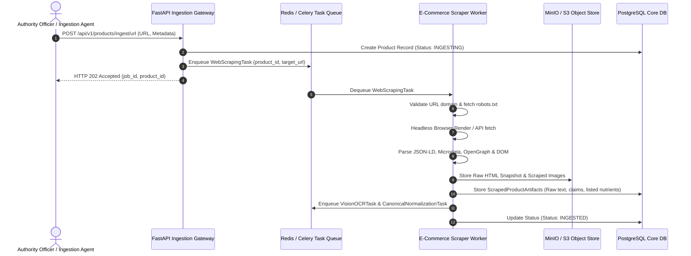
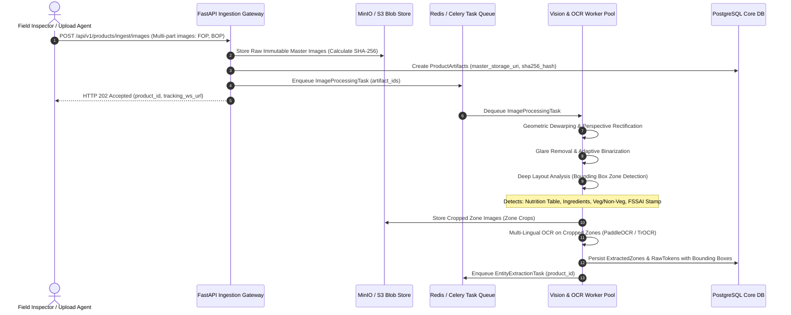
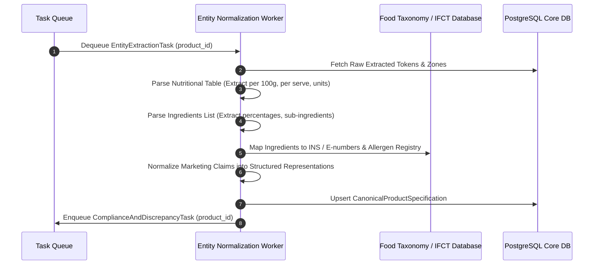
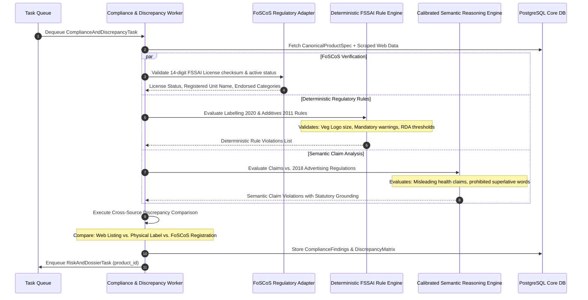

# DRISHTI: End-to-End Data Flow Architecture
## Phase 0: Data Pipelines, State Transitions & Interface Contracts

---

### 1. High-Level Data Flow Lifecycle

The DRISHTI system processes raw, unstructured, multi-modal evidence into legally defensible regulatory intelligence through six sequential pipeline phases:

```
[ Phase 1: Ingestion ] ────────> [ Phase 2: Vision & OCR ] ────────> [ Phase 3: Normalization ]
 - Product URLs                   - Image Preprocessing               - Ingredient Taxonomy
 - FOP/BOP Packaging Images       - Zone Layout Detection             - Nutritional Standardization
 - Raw Metadata Descriptions      - Multi-Lingual OCR                 - Claim Deconstruction
                                                                               │
                                                                               ▼
[ Phase 6: Case Workflow ] <──── [ Phase 5: Risk & Dossier ] <────── [ Phase 4: Compliance & Sync ]
 - FSO Field Assignment           - Multi-Factor Risk Score           - FSSAI Rules Evaluation
 - Improvement Notice Gen         - Certified Dossier PDF/A           - FoSCoS License Lookup
 - Adjudication Audit Log         - Cryptographic Hash Seal           - Cross-Source Discrepancy
```

---

### 2. Detailed Pipeline Sequence Flows

#### 2.1 Pipeline Flow A: URL Ingestion & Web Data Extraction



#### 2.2 Pipeline Flow B: Multi-Image Packaging & Multi-Zone OCR



#### 2.3 Pipeline Flow C: Canonical Entity Extraction & Taxonomy Resolution



#### 2.4 Pipeline Flow D: Regulatory Compliance, FoSCoS Sync & Cross-Source Consistency



---

### 3. Core Data Transfer Objects (DTOs) & Interface Contracts

To guarantee system stability, all modules communicate strictly through strongly-typed Pydantic V2 / JSON Schema contracts:

#### 3.1 Ingestion DTO: `IngestionRequestDTO`
```json
{
  "submission_source": "AUTHORITY_PORTAL",
  "product_url": "https://www.example-grocery.in/p/energy-bar-delight-10293",
  "product_title_hint": "Organic Energy Bar Deluxe",
  "declared_category": "HEALTH_SUPPLEMENTS_AND_NUTRACEUTICALS",
  "officer_badge_id": "FSO-KA-BLR-041",
  "district_code": "KA-BLR-URBAN",
  "notes": "Suspected misleading diabetic-friendly claim with undeclared high maltodextrin."
}
```

#### 3.2 Canonical Product Specification: `CanonicalProductSpecificationDTO`
```json
{
  "product_id": "d7b1a23e-8f92-4c28-98e1-5e8a3b1a8f90",
  "brand_name": "NutriPure Botanicals",
  "product_name": "DiabaCare Herbal Wellness Bar",
  "fssai_license_number": "11221334000567",
  "serving_size": { "value": 40.0, "unit": "g" },
  "servings_per_pack": 1.0,
  "nutritional_facts_per_100g": {
    "energy_kcal": 380.0,
    "protein_g": 6.5,
    "carbohydrates_g": 72.0,
    "total_sugars_g": 24.5,
    "added_sugars_g": 18.0,
    "dietary_fiber_g": 4.2,
    "total_fat_g": 8.0,
    "saturated_fat_g": 3.2,
    "trans_fat_g": 0.05,
    "sodium_mg": 180.0
  },
  "ingredients": [
    {
      "sequence": 1,
      "raw_name": "Maltodextrin",
      "normalized_name": "Maltodextrin",
      "percentage": 35.0,
      "ins_number": null,
      "is_additive": false,
      "is_allergen": false
    },
    {
      "sequence": 2,
      "raw_name": "Soy Protein Isolate",
      "normalized_name": "Soy Protein Isolate",
      "percentage": 15.0,
      "ins_number": null,
      "is_additive": false,
      "is_allergen": true,
      "allergen_group": "SOY"
    },
    {
      "sequence": 3,
      "raw_name": "Permitted Artificial Sweetener (INS 955)",
      "normalized_name": "Sucralose",
      "percentage": null,
      "ins_number": "INS 955",
      "is_additive": true,
      "additive_function": "ARTIFICIAL_SWEETENER"
    }
  ],
  "declared_claims": [
    {
      "claim_text": "Zero Added Sugar",
      "location": "FRONT_OF_PACK",
      "category": "NUTRIENT_CONTENT"
    },
    {
      "claim_text": "Clinical Strength Diabetes Management & Blood Sugar Regulator",
      "location": "FRONT_OF_PACK",
      "category": "DISEASE_RISK_REDUCTION"
    }
  ]
}
```

#### 3.3 Discrepancy Matrix: `DiscrepancyMatrixDTO`
```json
{
  "product_id": "d7b1a23e-8f92-4c28-98e1-5e8a3b1a8f90",
  "discrepancies": [
    {
      "field": "added_sugars",
      "source_web": "0g (Advertised as Sugar Free)",
      "source_physical_label": "18.0g Added Sugars per 100g",
      "source_foscos": "N/A",
      "discrepancy_type": "DIRECT_CONTRADICTION",
      "severity": "CRITICAL",
      "statutory_violation": "Section 24, FSS Act 2006 (Misleading Advertisement)"
    },
    {
      "field": "manufacturer_unit_address",
      "source_web": "Manufactured at Plot 12, Industrial Area, Peenya, Bengaluru",
      "source_physical_label": "Plot 12, Industrial Area, Peenya, Bengaluru",
      "source_foscos": "FoSCoS License 11221334000567 registered to Unit at Sonipat, Haryana",
      "discrepancy_type": "LICENSING_PREMISES_MISMATCH",
      "severity": "HIGH",
      "statutory_violation": "Regulation 2.1.2, FSS (Licensing & Registration) 2011"
    }
  ]
}
```

#### 3.4 Risk Evaluation & Evidence Dossier DTO: `RiskEvaluationDTO`
```json
{
  "product_id": "d7b1a23e-8f92-4c28-98e1-5e8a3b1a8f90",
  "composite_risk_score": 88.5,
  "risk_tier": "CRITICAL",
  "priority_rank": "PRIORITY_1_URGENT_INSPECTION",
  "dimension_scores": {
    "health_hazard_score": 75.0,
    "deception_and_misbranding_score": 98.0,
    "licensing_integrity_score": 90.0,
    "vulnerable_demographic_multiplier": 1.1
  },
  "actionable_recommendations": [
    "Issue Section 32 Improvement Notice for deceptive claim 'Zero Added Sugar'",
    "Direct territorial FSO to draw official Form VA samples from Peenya premises",
    "Initiate FoSCoS license scope review with Haryana Central Licensing Authority"
  ],
  "dossier_sha256": "9f86d081884c7d659a2feaa0c55ad015a3bf4f1b2b0b822cd15d6c15b0f00a08",
  "dossier_pdf_url": "s3://drishti-dossiers/2026/09/DOSSIER_KA_2026_09482.pdf"
}
```

---

### 4. Regulatory Case State Machine

Every investigated product SKU transitions through an auditable, deterministic lifecycle state machine:

```
                  +-------------------+
                  |     SUBMITTED     |
                  +---------+---------+
                            | Ingestion initiated
                            v
                  +-------------------+
                  |     INGESTING     |
                  +---------+---------+
                            | Web scraped & images stored
                            v
                  +-------------------+
                  |     EXTRACTED     |
                  +---------+---------+
                            | OCR & Canonical Spec normalized
                            v
                  +-------------------+
                  |COMPLIANCE_ANALYZED|
                  +---------+---------+
                            | FSSAI rules & discrepancies evaluated
                            v
                  +-------------------+
                  |    RISK_SCORED    |
                  +---------+---------+
                            | Dossier generated & signed
                            v
                  +-------------------+
                  |   TRIAGE_READY    |
                  +---------+---------+
                            |
           +----------------+----------------+
           | Low Risk                        | High/Critical Risk
           v                                 v
+---------------------+           +---------------------+
| ARCHIVED_MONITORING |           |  ASSIGNED_TO_OFFICER|
+---------------------+           +----------+----------+
                                             |
                                             v
                                  +---------------------+
                                  | FIELD_INSPECTION_ORD|
                                  +----------+----------+
                                             |
                                             v
                                  +---------------------+
                                  | NOTICE_ISSUED_SEC32 |
                                  +----------+----------+
                                             |
                         +-------------------+-------------------+
                         | Compliance Met                        | Legal Prosecution
                         v                                       v
              +---------------------+                 +---------------------+
              |     CASE_RESOLVED   |                 | ADJUDICATION_PENDING|
              +---------------------+                 +---------------------+
```

---

### 5. Storage Tier Caching and Persistence Lifecycle

| Data Type | Primary Storage | Secondary Storage / Cache | Retention / Immutability Policy |
|---|---|---|---|
| **Raw Master Images** | MinIO / S3 Object Store | Local Worker Temp Cache | Permanent, Immutable, SHA-256 Verified |
| **Zone Image Crops** | MinIO / S3 Object Store | Web CDN / Presigned S3 URLs | 3 Years (Retained for evidence audit) |
| **Scraped HTML Snapshots** | MinIO / S3 Object Store | None | 1 Year (E-commerce archive) |
| **Relational Metadata & Logs** | PostgreSQL 16 | Redis 7 (LRU Query Cache) | Permanent with Write-Ahead Logging (WAL) |
| **Active Celery Task State** | Redis 7 Key-Value | None | TTL = 24 Hours (Purged on job finish) |
| **FoSCoS Cache Records** | Redis 7 Key-Value | PostgreSQL FoSCoSSync table | TTL = 12 Hours (Prevent registry hammering) |
| **Certified PDF Dossiers** | MinIO / S3 Object Store | None | Permanent, Cryptographically Sealed |
